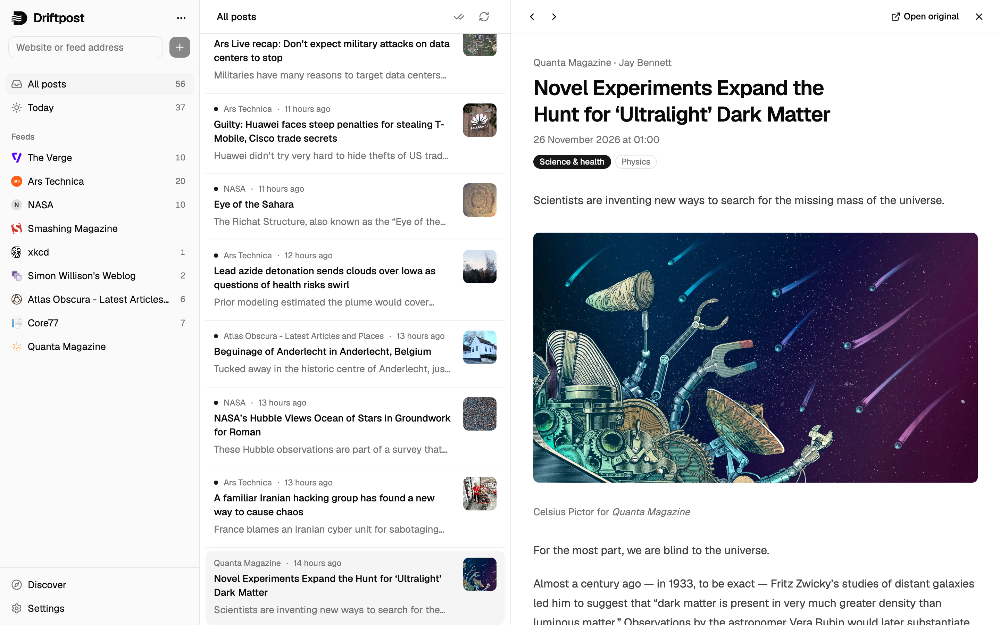
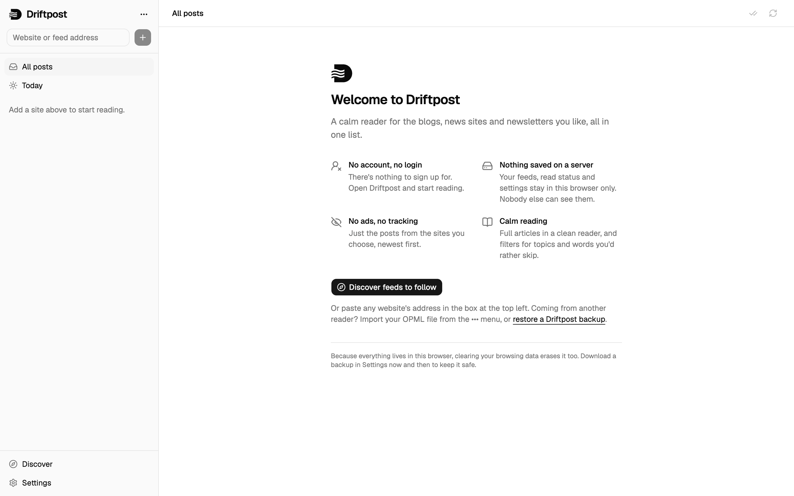
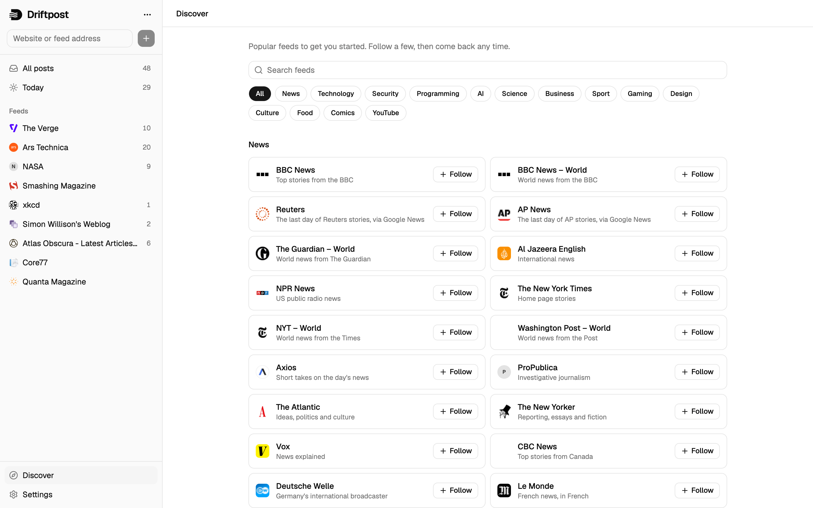
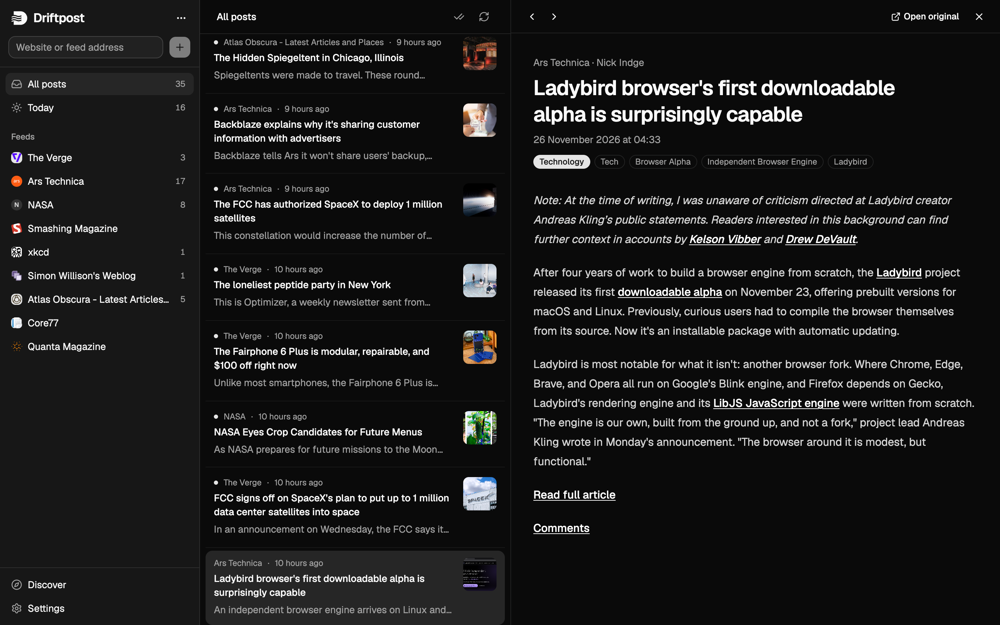
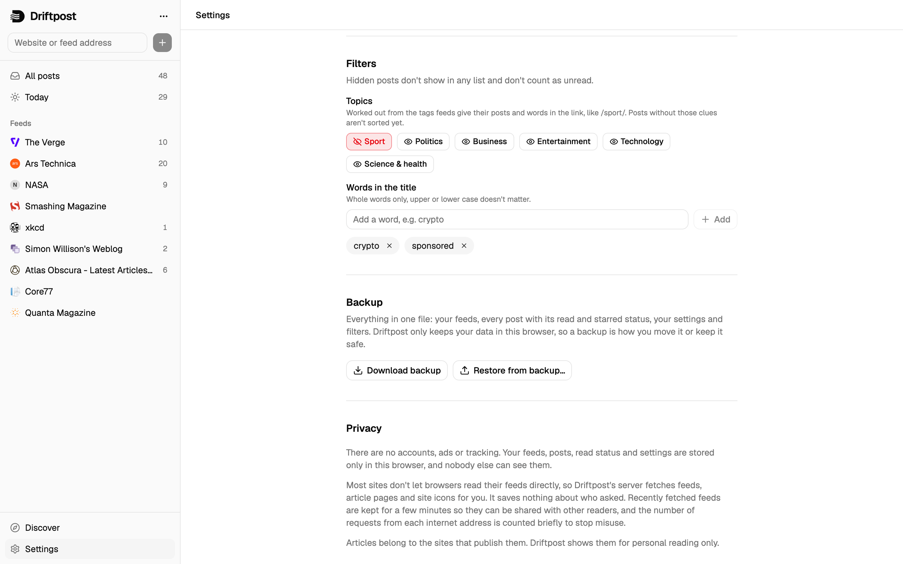
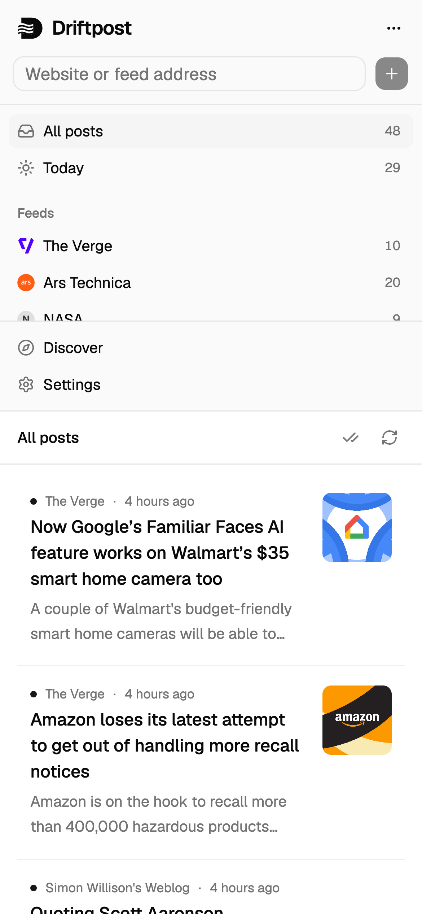

# Driftpost

A calm feed reader for blogs and news sites, all in one list.

**No account, no login, nothing saved on a server.** Your feeds, read status and settings live only in your own browser.

Live: https://driftpost.cloudflare-constrain275-202.workers.dev · [What's new](CHANGELOG.md) · [Releases](https://github.com/ba1234scx234s/driftpost/releases)



## Why it's different

- **Private by design.** There are no accounts. Everything is stored in your browser (IndexedDB), so nobody else, not even the server, knows what you follow or read.
- **No ads, no tracking, no algorithm.** Just the posts from the sites you choose, newest first.
- **Made for reading.** Articles open in a clean reader with the full text, your choice of font and text size, and light or dark mode.

## Features

### Start in seconds

New visitors get a short welcome that explains how Driftpost works and points them to feeds worth following. Paste any website's address (Driftpost finds its feed), pick from Discover, or import an OPML file from another reader.



### Discover

A hand-picked catalogue of popular feeds in 14 categories, from news and tech to science, design, comics and YouTube channels. Following takes one click, and feeds you already follow are marked.



### A reader that stays out of the way

- **Full articles:** when a feed only gives a summary, Driftpost fetches the article's text so you can read it in place. You can also have articles open on the original site instead.
- **Keyboard friendly:** ← and → step through posts, Esc closes the reader.
- **Light and dark:** follows your system, or pick one.



### Filters for what you'd rather skip

Hide posts by topic (Sport, Politics, Business…), by words in the title, or by a feed's own tags. Click a tag on any post to hide it, or select words in an article to turn them into a filter. Hidden posts don't count as unread.



### Keeps the noise down

- **Hide read posts:** lists show only what's new. A post you open stays put until you switch lists, so the arrow keys keep working.
- **Hide read feeds:** feeds with nothing unread tuck away behind an "N feeds read" link.
- **Mark as read while scrolling**, and **Today** for just the day's posts.
- **No duplicates:** the same feed is caught even when it hides behind a different address.

### Yours to keep

Because everything is in your browser, Settings → Backup downloads it all in one file: feeds, every post with its read and starred status, settings and filters. Restore it in any browser. Subscriptions also import and export as OPML.

### Works on your phone



## How it works

Driftpost is a single-page React app served by a small Cloudflare Worker.

- **In the browser:** the app parses RSS, Atom and JSON Feed, stores everything in IndexedDB (via Dexie) and does all filtering locally.
- **On the Worker:** most sites don't let browsers read their feeds directly (CORS), so the Worker fetches feeds, article pages and site icons on the app's behalf. It stores and logs nothing about who asked. It only passes on text (feeds, web pages, JSON), shares recently fetched feeds between readers for 10 minutes, and limits requests per visitor to stop misuse.

Built with Vite, React, TypeScript, Tailwind CSS and shadcn/ui.

## Development

```bash
npm install
npm run dev      # app and Worker together on http://localhost:5173
npm run deploy   # type-check, build and deploy to Cloudflare
```

## Licence

[MIT](LICENSE): free to use, change and share, including commercially, as long as the copyright notice stays in.
